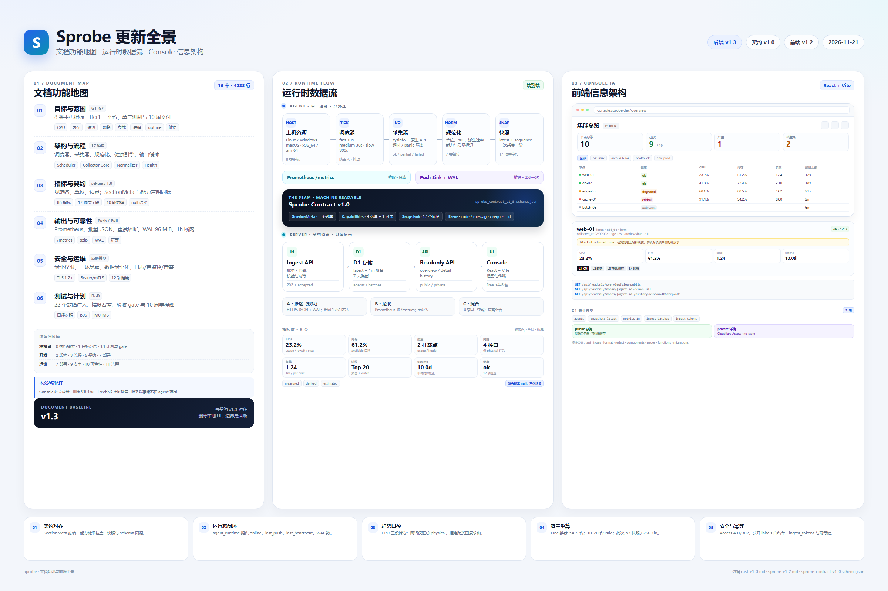
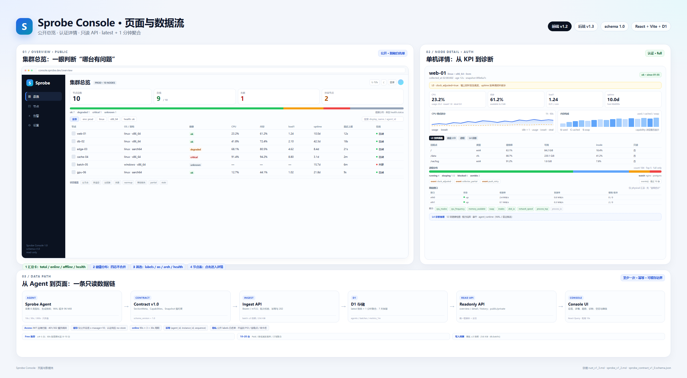

# Sprobe 更新图示：文档功能与前端

> 依据：`../backend/rust_v1_3.md`（后端 v1.3）、`../../contract/sprobe_contract_v1_0.schema.json`（契约 v1.0）、`../frontend/sprobe_v1_2.md`（前端 v1.2）  
> 日期：2026-11-21  
> 用途：把更新后的文档结构、运行时链路和 Console 页面放在同一张图上，便于评审、宣讲和开发对齐。

## 图 1：文档功能与前端全景

图中三列分别对应：

| 区域 | 内容 | 读图方式 |
| --- | --- | --- |
| 01 文档功能地图 | 目标范围、架构流程、指标契约、输出可靠性、安全运维、测试计划 | 先看 01–06 的章节职责，再看底部“本次边界修订” |
| 02 运行时数据流 | 主机 → 调度 → 采集 → 规范化 → 快照 → 契约 → 服务端 → Console | 关注 Agent 侧、Contract 接缝、Server 侧三段 |
| 03 前端信息架构 | `/overview` 总览与 `/nodes/:id` 详情的页面骨架 | 看汇总卡、健康分布、节点表，以及 L1–L4 详情分层 |
| 底部更新条 | 契约对齐、运行态闭环、趋势口径、容量重算、安全与幂等 | 对应本次 v1.3 / v1.2 的五个主要修订 |

图中关键口径：

- 后端文档 16 章、4223 行；规范指标 86 个；模块 17 个；故障注入 22 项。
- 快照契约 v1.0 的 `SectionMeta` 5 个必填字段；`Capabilities` 9 个必填 + 1 个可选；`Snapshot` 17 个顶层字段。
- 可靠性：推送为主、拉取为辅；WAL 96 MiB；断网/服务端不可用 1 小时不丢数。
- 前端：公开总览脱敏、认证详情需 Access；D1 只保留 latest + 1 分钟聚合；Free 推荐 ≤4–5 台。

## 图 2：Console 页面与数据流

图中上半部分是两张页面线框，下半部分是一条只读数据链：

| 区域 | 内容 | 读图方式 |
| --- | --- | --- |
| 01 `/overview` | 汇总卡、健康四态分布、筛选、节点表、8 类状态覆盖 | 先看“哪台有问题”，再看表格定位 |
| 02 `/nodes/:id` | 顶部上下文、L0 异常横幅、L1 KPI、L2 趋势、L3 存储/进程、L4 诊断抽屉 | 重点关注 L0 与 L4，它们承载新版的运行态和诊断能力 |
| 03 Data Path | Agent → Contract → Ingest → D1 → Readonly API → Console | 关注 Access、缓存、online、幂等、隐私五个边界 |

图中关键口径：

- `online` 判定：`now - max(last_push_at, last_heartbeat_at) <= 90s`（3 × 30s 周期）。
- 缓存边界：仅公开总览可边缘缓存（`s-maxage=10`）；认证响应 `private, no-store`。
- 隐私边界：公开视图使用 labels 白名单，不返回 PID、挂载点、网卡名、完整 hostname。
- 趋势边界：网络仅汇总 `class == "physical"` 的接口；CPU 展示 `usage / iowait / steal`，idle 由三者派生。
- 容量边界：单批 ≤3 快照、≤256 KiB；Free 推荐 ≤4–5 台，10–20 台需 Paid 或降频/只写聚合。

## 与源文档的对应关系

| 图中内容 | 源文档位置 |
| --- | --- |
| 目标、范围、非目标 | `../backend/rust_v1_3.md` 第 1 章 |
| 模块职责与逻辑架构 | `../backend/rust_v1_3.md` 2.2–2.3 |
| 关键流程与资源预算 | `../backend/rust_v1_3.md` 第 3 章 |
| 指标定义、边界与质量 | `../backend/rust_v1_3.md` 第 4 章、附录 A |
| 快照、批次、HTTP、错误 | `../backend/rust_v1_3.md` 第 6 章；`../../contract/sprobe_contract_v1_0.schema.json` |
| 配置、部署、升级回滚 | `../backend/rust_v1_3.md` 第 7 章 |
| 推送、WAL、背压 | `../backend/rust_v1_3.md` 第 8 章 |
| 安全与隐私 | `../backend/rust_v1_3.md` 第 9 章 |
| 健康、日志、告警 | `../backend/rust_v1_3.md` 第 11 章 |
| 验收与计划 | `../backend/rust_v1_3.md` 第 12–13 章 |
| 前端页面、API、D1、部署 | `../frontend/sprobe_v1_2.md` 第 5–10 章 |
| 前端字段映射 | `../frontend/sprobe_v1_2.md` 附录 A |

## 维护说明

- 两张图由本地 HTML/CSS 渲染，源文件保存在同目录的 `src/diagram1.html`、`src/diagram2.html`。
- 修改源文档的指标数、契约字段或前端路由后，同步更新图中数字与节点，再重新渲染，避免“图比文档新”。
- 图中配置、JSON、HTTP 均为契约示意，不是代码实现。
